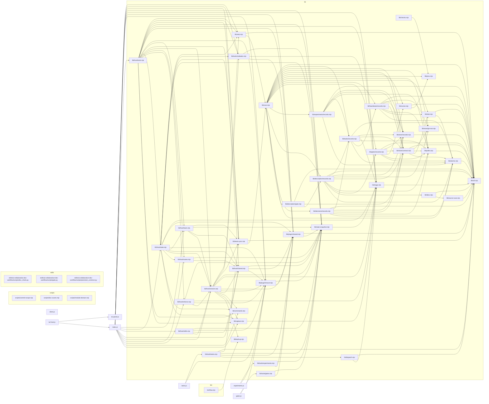
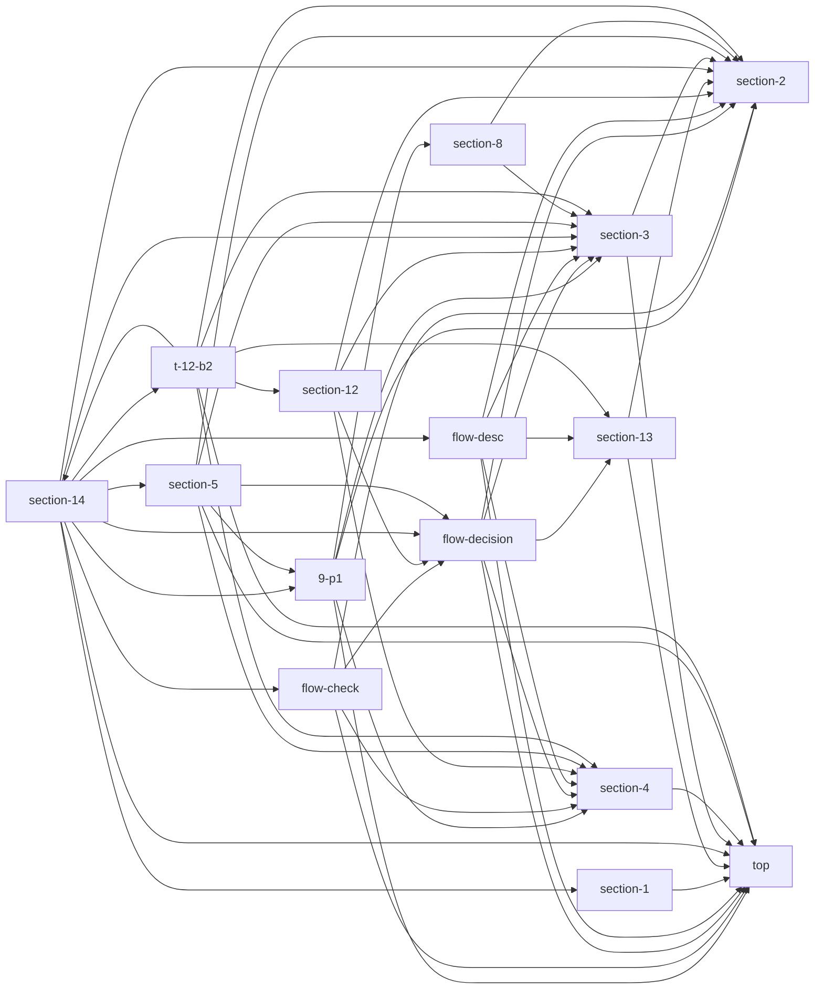
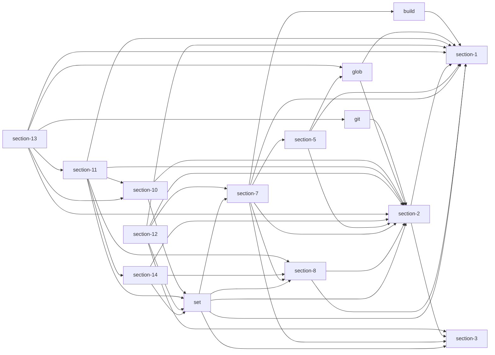
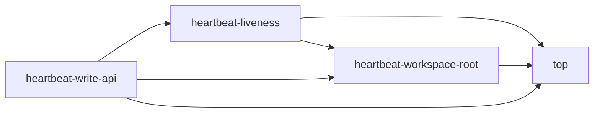
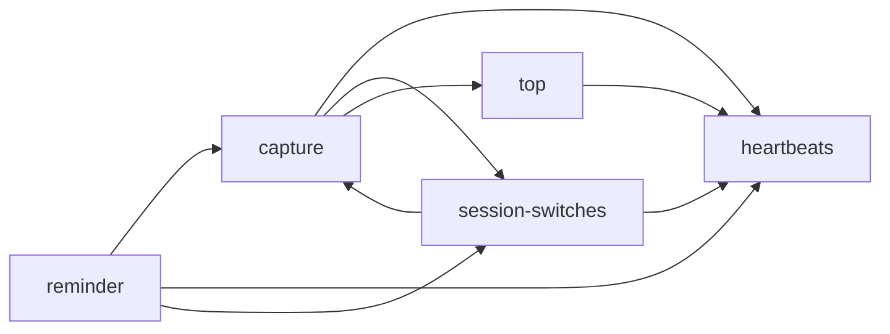
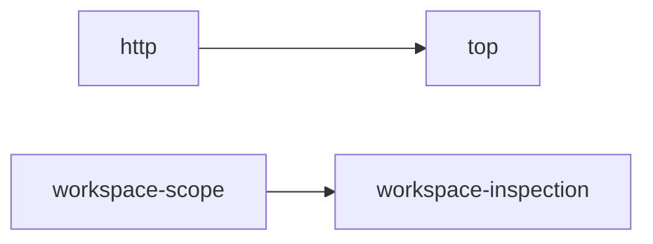
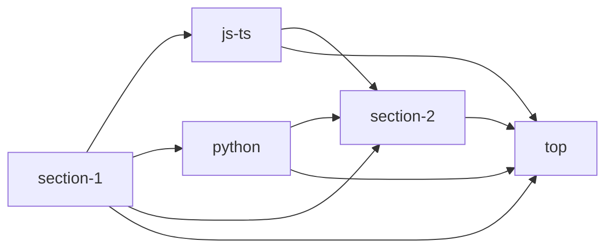
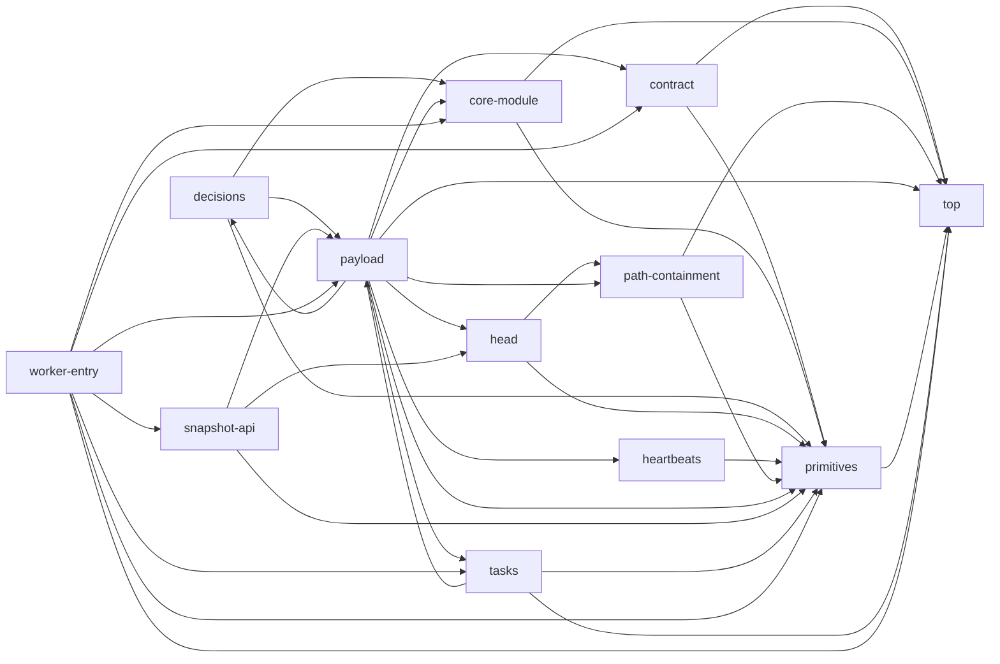
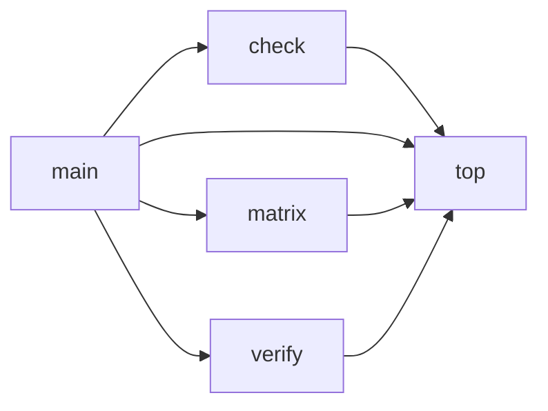

# 项目描述：project-flow

> 生成物：由 `flow desc render` 从 `.agents/description/` 生成，不要手改。
> 文件 56 ｜ 模块 120 ｜ 未描述 0

## 1 项目语义

project-flow：以 .dsh/flow 为单一真相源的项目流程台账（实验/任务/门禁/决策/心跳）与只读面板；description 台账记录文件图、模块图与模块语义，并在分析→执行→审查三阶段强制同步。

## 2 文件关系图

## 3 文件与模块

### 3.1 bin/flow.mjs

project-flow 的唯一 CLI 入口（package.json 的 bin 字段），由 skills 与测试以子进程方式调用：解析 argv、按命令分派、格式化人类/--json 输出，并把错误映射成 0/1/2/3/4 退出码。它不直接读写 .dsh/flow 台账——存储、校验与门禁执行全部懒加载委托 lib/core.mjs（脚本检查另走 lib/checks.mjs）——因此台账语义变更应落在 core/desc，而不是这个文件。

| 模块 | 语义 | 成员 |
|---|---|---|
| top | CLI 的静态契约层：保存 USAGE 帮助文本、两套退出码映射，以及 BOOL/VALUE/REPEAT 三类 flag 全集和按（命令,子命令）声明的 SPEC 白名单；assertFlagsAllowed 在任何 core 读写之前拒绝未声明的 flag，使不支持参数不可能触达写路径。 | USAGE、EXIT、EXIT_BY_CODE、CHECK_EXIT_BY_CODE、STATUS_HEARTBEAT_ROWS、BOOL_FLAGS、VALUE_FLAGS、REPEAT_FLAGS、SPEC、GLOBAL_FLAGS、specOfSpec、describeFlags、assertFlagsAllowed、CliError |
| section-1 | 把原始 argv 拆成 flags、repeated 与 positional：支持 --k=v 与 --k v、把 -h 归一成 help，并按 BOOL/VALUE/REPEAT 集合校验取值；未知参数与缺值只记入 errors 不立即抛，由 main 统一按 usage 失败。 | parseArgv |
| section-2 | 终端与 --json 输出的共享原语：stdout/stderr 写入、JSON 信封、按 CJK 双宽计算的对齐/截断/表格，以及时间与耗时格式化；只在人类输出路径使用，其中 pad 与 lib/util.mjs 的同名函数语义不同、不可合并。 | jsonMode、topCommand、out、errOut、emitJson、charWidth、textWidth、pad、clip、table、fmtTime、fmtDuration |
| section-3 | 心跳、决策与 status 共用的前置与展示辅助：读 DSH 会话日志头判定 delegation（子会话禁止写心跳）、把心跳根解析到项目主工作区，并集中收集 core/契约警告、提供年龄/会话短名/claims 格式化。 | readSessionHeader、zstdText、sessionOriginOf、assertMainSessionHeartbeat、heartbeatWorkspaceOf、fmtAge、shortSession、fmtClaims、pendingWarnings、coreRef、collectWarnings、drainCoreWarnings、loadContractFor、printWarnings |
| section-4 | 把 flags 里的原始字符串归一成命令可用的强类型值：非负/正整数、JSON 对象或任意 JSON（desc set 允许数组）、逗号列表、必填字符串与 gate --step 的 'id=命令>>expect'；格式不合法一律抛 usage，不做静默降级。 | readString、readInteger、readPositiveInteger、readJsonObject、readJsonValue、readList、requireString、parseStep |
| section-5 | init 与 status 两条命令的实现：init 把 name/force/no-gates 转交 core.initProject 并打印新建文件与种子门禁；status 聚合实验/任务/门禁/决策/心跳/描述计数，并刻意区分「台账未初始化或不可读」与「计数为零」。 | cmdInit、unreadableTail、countsOf、cmdStatus、cmdBackup、cmdDoctor、byteText |
| t-12-b2 | exp 与 task 两类命令的实现：收集各子命令 flag，把 schema-2 七个判定字段与 parent/experiment 归一后交给 core，并输出表格或记录详情；CLI 只做输入归一与展示，所有落盘仍由 core 在写锁内完成。 | splitEntries、experimentSeven、cmdExp、printArchiveResult、readParentFlag、cmdTask |
| flow-desc | flow desc 子命令面（status/build/show/set/plan/apply/render）的实现，以及同一源码段内、没有独立段头的 gate 子命令（list/show/add/update/enable/disable/rm/run/logs）；desc 的台账读写与校验全部委托 core，仅 desc plan --template 懒加载 lib/desc.mjs 做只读源码扫描，--out 与 description.render 被限制在项目根内。 | descModeOf、descInsideRoot、descRelativeLabel、descTreeLines、descPlanShape、printDescPlan、loadDescModel、descPlanTemplate、cmdDesc、cmdGate |
| section-8 | 心跳记录的人类可读详情：把 session/agent/goal/task/claims/status/年龄/turn/时间戳/stats 排成对齐的 label-value 行；纯展示、不改记录，start/update/end/status 复用同一渲染。 | printHeartbeat |
| 9-p1 | §9 项目状态块与 heartbeat 子命令的 CLI 侧：懒加载 lib/capture.mjs 的 buildStatusBlock 作为栈与计数的唯一真源，这里只做显示截断（HEARTBEAT_STACK_ROWS=5）和折叠提示，并编排 start/update/end/list/status/gc；块装配失败只记 warning，绝不让已落盘的心跳写入失败。 | HEARTBEAT_STACK_ROWS、heartbeatStatusBlock、loadCapture、statusBlockOf、printStatusBlock、printHeartbeatList、cmdHeartbeat |
| flow-check | flow check 的分派层：check list 合并 lib/checks.mjs 的脚本检查与内置 BUILTIN_CHECKS（decisions/experiments/tasks/description），四个内置项在此特判路由到 core、其余才懒加载 checks 模块；退出码按检查语义归一（失败 1、用法 2、缺失 3、IO 4）。 | loadChecks、BUILTIN_CHECKS、cmdCheck |
| flow-decision | 决策台账命令与四个内置检查的实现：decision ask/list/show/answer/withdraw/gc 的输入归一（answer 会自动应用否决），以及 check decisions/experiments/tasks/description 的只读执行、逐行报告与 check-failed 载荷；检查不写盘，台账写仍全部委托 core。 | parseDecisionOption、decisionSessionInfo、decisionSuspended、printDecisionList、cmdDecision、runCheckDecisions、runCheckExperiments、loadTypeMap、warnTypeMapExtras、runCheckTasks、runCheckDescription |
| section-12 | flow task normalize 的 CLI 实现：先用只读预览（fix:false）算归一结果，--dry-run 只报告、真跑才在 core 写锁内迁移，写盘后再读盘统计真实残留；永不猜 type，合并后 title 超过 120 列时提示复查。 | TASK_TITLE_REVIEW_WIDTH、plannedTaskTitle、displayWidthOf、runTaskNormalize |
| section-13 | 命令的人类输出辅助：printRecord/printGate/printRun/printGatePhaseRun/printTree 负责记录、门禁、运行、phase 批运行与树形结构的排版；confirmDelete 负责 rm 前确认（--yes 可跳过；--json 或非 TTY 必须显式 --yes，绝不隐式删除）。 | printRecord、printGate、printRun、printGatePhaseRun、printTree、confirmDelete |
| section-14 | 进程入口：懒加载 core 与 team-sync（缺模块时给可操作的 io 错误），把 show/update/rm 等子命令的位置参数归一到 flags.id、按命令分派到各 cmd*，并在成功/失败两条路径统一收集 warnings、把 CliError 与检查载荷映射成 0/1/2/3/4 退出码。 | loadTeamSync、loadCore、exitCodeOf、dispatch、main |

### 3.2 client.js

web 侧的看板客户端（`@local/project-flow` 的浏览器半边）：单文件、无构建、除 `react` 外无依赖，由一个 `window.__ModuleLoader__.load` 工厂向宿主注册「项目流」右栏标签页（`sidebarRightTabs` 的类型与 guide、`sidebar.right.pane.tab` 正文、标题 chip、会话头部一键打开），并按容器宽度把实验树、任务台账、门禁、心跳、决策渲染成一列或两列。面板严格只显示所在会话的工作区：单飞轮询 `api/project-flow/state?root=`（一次请求落定后再 arm 2500ms，teardown 只中止在飞请求且不再写状态），读失败保留上次好数据并标 stale，写操作只有 `init` 与 `gate` 两个已文档化的 POST。

（无模块）

### 3.3 experiments.js

可选子插件入口 `@local/project-flow/experiments`：只把 `flow_exp` 一个模型工具经 `lib/plugin/mount.mjs` 的 `mountModule` 挂到宿主 `tools` 服务上，让宿主 profile 按需选择工具面（可与共享插件并存，也可单独挂载）。不注册路由、技能或钩子，也不复制任何工具规则；`tools` 服务缺失时是静默 no-op，失败只进 mount warning 而不抛。

| 模块 | 语义 | 成员 |
|---|---|---|
| experiments | 整文件即入口：唯一导出的 `apply(ctx, config)` 忽略 config，只调用一次 `mountModule(ctx, { label: 'experiments', buildDefinition })`，工具 schema、字段白名单、上限与 root 解析全部来自 lib/tools/experiments.mjs 与共享依赖注入，本文件不持有任何规则副本。 | apply |

### 3.4 gates.js

可选子插件入口 `@local/project-flow/gates`：只把 `flow_gate` 一个模型工具经 `lib/plugin/mount.mjs` 的 `mountModule` 挂到宿主 `tools` 服务上，让宿主 profile 按需选择工具面（可与共享插件并存，也可单独挂载）。不注册路由、技能或钩子，也不复制任何工具规则；`tools` 服务缺失时是静默 no-op，失败只进 mount warning 而不抛。

| 模块 | 语义 | 成员 |
|---|---|---|
| gates | 整文件即入口：唯一导出的 `apply(ctx, config)` 忽略 config，只调用一次 `mountModule(ctx, { label: 'gates', buildDefinition })`，工具 schema、字段白名单、上限与 root 解析全部来自 lib/tools/gates.mjs 与共享依赖注入，本文件不持有任何规则副本。 | apply |

### 3.5 index.js

project-flow 的宿主入口（装配层）：声明 inject=['webServer'] 并 apply 一次装配——把读/写路由交给 lib/host/state.mjs 与 lib/host/routes.mjs，把工具、技能、系统提示、会话钩子与权限面交给 lib/host/* 的对应模块；本文件只做装配与 mountJsonRoute，不含业务实现。

| 模块 | 语义 | 成员 |
|---|---|---|
| tools | 装配：mountJsonRoute 把一条路由挂到 webServer（effect 内注册、卸载即注销）；apply 依次建 state 池、挂三条路由、注册工具/技能/提示/提醒/心跳钩子，并用 sessionHooks 注入 restrict 与 team caller 记忆。 | mountJsonRoute、apply |

### 3.6 lib/atomic.mjs

存储写路径的持久化原语：临时文件命名、零依赖同步 sleep、Windows 瞬时错误的有界退避 rename、best-effort 目录 fsync 与 ensureDir。writeJsonAtomic 把它们组合成唯一的 JSON 原子写入口，lib/core.mjs 只重导出公开名；本模块不 import core，也不管锁与契约。

| 模块 | 语义 | 成员 |
|---|---|---|
| atomic | writeJsonAtomic 走临时文件 open(wx)+fsync+rename，任一步失败即删临时文件并抛 FlowError(io)；rename 只对 EPERM/EBUSY/EACCES 按 RENAME_RETRY_DELAYS_MS 退避重试，其余错误第一次就失败，目录 fsync 纯 best-effort、失败绝不影响已成功的写入。 | RENAME_RETRY_DELAYS_MS、ensureDir、SLEEP_BUFFER、sleepSync、renameWithRetrySync、fsyncDirBestEffort、writeJsonAtomic |

### 3.7 lib/backup.mjs

台账快照与体检：把被 git 忽略的 .agents 复制到 .agents-backups/<stamp>（跳过 worktrees/tmp、按 keep 剪枝），并给 flow doctor 提供契约/记录目录/git 忽略/快照新鲜度检查与挂载告警。

| 模块 | 语义 | 成员 |
|---|---|---|
| backup | createBackup 写快照并剪枝；listBackups/latestBackup 列快照；doctorReport 产出 ok/warn/error 结论；backupHealthWarning 供宿主在会话创建时提示过期；全部零依赖、不 import core。 | BACKUP_DIR、DEFAULT_KEEP、DEFAULT_STALE_HOURS、EXCLUDED_TOP、isExcluded、backupDirOf、backupStamp、countFiles、dirSize、listBackups、latestBackup、createBackup、gitProbe、readContract、doctorReport、backupHealthWarning |

### 3.8 lib/capture.mjs

P1 捕获流水线：agent/pre-step 只做内存的排除/集合差去重，agent/turn-stopping 才落盘（source.key 跨进程去重、创建即推进 queued-analysis）；同时产出 §9 状态块与栈顶选取。系统/同伴/后台任务通知按前缀排除，用户聊天才建卡；不 import core（core 由 index.js 注入，宿主无 core 时捕获自然降级）。

| 模块 | 语义 | 成员 |
|---|---|---|
| capture | 以 <root,session> 分桶维护待捕获队列与 lastKeys/seen 去重键，经结构排除、挂载窗口、命令前缀筛选后，由 flushCapture 按时间倒序串行写台账（source.key 预去重，失败把未写项回滚进队列），并输出可区分的 skip/excludedBy/error 诊断与栈顶/计数状态块；唯一写盘点固定在 turn-stopping。附件保真：attachmentsOfContent 把 image/file 块归一化为 source.attachments（畸形块跳过），utteranceKeyOf 以稳定消息 id 建身份键，attachmentTitle 为纯附件消息生成兜底标题。 | CAPTURE_CONTEXT_SENTINEL、SYSTEM_MESSAGE_PREFIXES、PEER_MESSAGE_PREFIXES、COMMAND_PREFIX、exclusionReasonOf、STACK_LIMIT、RECENT_CAPTURED_LIMIT、CAPTURED_TASK_TYPE、TITLE_MAX、SOURCE_TEXT_MAX、CAPTURE_GRACE_MS、isPlainObject、timeValue、compareStack、effectiveStage、isUnfinished、textOfContent、utteranceKey、isExcludedText、extractUtterance、stampOf、clipTitle、sourceTextOf、timestampMsOf、createCaptureState、markCapture、noteCaptureGate、describe、captureSummary、bucketKey、bucketOf、mountedAtOf、recordPreStep、pendingUtterances、flushCapture、compareUtteranceDesc、readTasks、captureStack、stackTop、TEAM_UNAVAILABLE、teamStatusOf、buildStatusBlock、stageName、utteranceKeyOf、attachmentsOfContent、attachmentTitle |

### 3.9 lib/checks.mjs

flow check 的只读命令层：声明随包分发的四个机械检查脚本（staged / release-baseline / state / doc），把 CLI 选项映射成脚本 argv，spawn bash/python3 执行并把结果归一化为 0/1/2/3/4 退出码。bin 的 check 路由与 flow check <name> 依赖它；它不 import core、不读写 .dsh/flow，进程树杀灭复用 lib/proc.mjs，脚本按包根而非 --root 解析。

| 模块 | 语义 | 成员 |
|---|---|---|
| top | RAW_CATALOG 固定四个检查及其解释器与参数契约，getCheck/listChecks 对外暴露；buildInvocation 只做参数合法性校验（未知检查、缺 --allow/--marker/--file/--type 一律 usage 报错），不触碰文件系统。 | DEFAULT_TIMEOUT_SECONDS、MAX_CAPTURE_BYTES、SCRIPTS_REL、SCRIPTS_DIR、DOC_TYPES、CHECK_EXIT_BY_CODE、RAW_CATALOG、CHECKS、scriptsDir、listChecks、getCheck、usageError、normalizeAllows、buildInvocation、CheckError |
| section-1 | runCheck 先确认脚本存在、根目录是目录，再 spawn 并在超时后杀进程树；stdout/stderr 各只留最后 8 KiB，退出码统一映射为 0/1/2/3/4，win32 在 taskkill 后仍有 2s grace 兜底 resolve，绝不让检查永久挂起。 | createTail、writeThrough、superviseCheckChild、runCheck |

### 3.10 lib/commands.mjs

识别并解析 /建议 /继续 /暂停 /开始 /决策 /状态 六条聊天命令，只做纯解析、从不执行。capture 用它跳过命令消息，每步提醒把命中的命令展示给模型；命令语义本身尚未定义。

| 模块 | 语义 | 成员 |
|---|---|---|
| commands | COMMANDS 是六条中文命令的唯一白名单；commandNameOf 剥掉斜杠后取首段（只用于展示），parseCommand 对裸斜杠、非命令与未知命令一律返回 null，rest 保留参数原文，两者都无副作用。 | COMMANDS、commandNameOf、parseCommand |

### 3.11 lib/core.mjs

flow store 的唯一写者与核心实现：契约解析、store 锁与原子写、实验/任务/门禁/决策/心跳/描述台账的校验与 CRUD 都收敛在这里，CLI（bin/flow.mjs）、flow_* 工具与只读面板共享它的导出。它只依赖 node 内置模块和 lib/{util,paths,atomic,lock,runner,stage,proc,desc}.mjs，不依赖 lib/checks.mjs，也不允许被 lib/desc.mjs 反向引用。

| 模块 | 语义 | 成员 |
|---|---|---|
| decisions | 决策、心跳、实验、任务共用的常量与默认值：决策状态/种类、问题与理由长度上限、固定 approve/reject 选项，心跳超时与 Windows 会话名黑名单，PLUGIN_BIN，EXPERIMENT_DEFAULTS/TASK_DEFAULTS 及可写字段白名单、DAY_MS；它们是 defaultContract 与各 build*/apply* 校验的唯一常量来源。 | PLUGIN_BIN |
| contract | 契约的读写与归一：defaultContract 给全部默认值，sanitizeContract 逐字段校验非法值并回退默认同时记 manifest-invalid，loadContract/saveContract 负责 flow.json，initProject 建库并 seed 门禁；storePaths 把契约目录解析为绝对路径并强制 containment，所有读写都先经过它。 | initProject |
| default-gate-seeds | flow init 时种子门禁（session-open/precommit/tests/release）的定义与写入，以及全库写路径共用的 withLock；不变量：只在 gates 目录里一个 .json 都没有时 seed，withLock 的 fn 必须同步且不可重入。 | defaultGateSeeds、seedDefaultGates |
| aggregate | 面板与 flow status 的只读聚合：readStoreState 一次读出 experiments/tasks/gates/decisions/heartbeat 段与状态计数，不跑 git、不执行门禁、不写盘。 | summarizeRun、readStoreState |

### 3.12 lib/decisions/records.mjs

决策域：D- 记录生命周期、答案与选项、GC、提醒排序、与任务/否决联动；依赖 tasks 与 gates（单向）。

| 模块 | 语义 | 成员 |
|---|---|---|
| records | 决策常量；buildDecision 校验；list/summarize 投影排序；answer/withdraw 终态不可变；gc 按会话归档清理；decisionAffectsMatch 供 staged 检查。 | DECISION_SCHEMA、DECISION_STATUS、DECISION_KINDS、DECISION_ESCALATE_TURNS、DECISION_ESCALATE_HOURS、DECISION_GC_DAYS、DECISION_REMIND_MAX、DECISION_OPTION_ID_RE、DECISION_QUESTION_MAX、DECISION_RATIONALE_MAX、DECISION_BY、DECISION_APPROVAL_OPTIONS、codePointLength、decisionFingerprint、normalizeDecisionAffect、normalizeDecisionAffects、normalizeDecisionBlocks、buildDecisionOptions、decisionOptionId、normalizeDecisionSupersedes、normalizeDecisionFields、buildDecision、decisionRecords、decisionIds、decisionSortedNewest、annotateDecision、decisionOpenOrder、decisionOwnedBy、decisionSessionOf、listDecisions、getDecision、decisionClosedHint、addDecision、requireOpenDecision、answerDecision、withdrawDecision、gcDecisions、clearDecisionPointers、purgeArchivedDecisions、summarizeDecisions、decisionAffectsMatch、decisionStagedFiles、checkDecisions |

### 3.13 lib/desc.mjs

lib/desc.mjs 是「项目描述台账」的模型层：只做纯计算与只读文件系统访问——路径/glob 归一、扫描结果到记录的建记录与对账、补丁与计划的归一核对、模块边推导、确定性 Markdown 渲染、git 降级探测都在这里，任何写盘（锁内编排 + 原子写）都不在本文件。它被 lib/core.mjs 以 desc.* 整体消费、被 bin/flow.mjs 的 `desc plan --template` 懒加载；依赖方向固定 core → desc → source-scan/util，本模块不得 import core。

| 模块 | 语义 | 成员 |
|---|---|---|
| section-1 | spec §1/§2 的硬编码默认与形状约束（语义下限 10 字符、模块 id 与任务 id 正则、文件/模块 op 集合、import kind 集合、默认 include/exclude、模块边 why 的上限）。用途是契约 description 节缺省时兜底，保证每个纯函数单独调用也自洽；有契约值时以契约为准，这里只是下限防呆。 | SCHEMA、MODULE_ID_RE、MODULE_ID_MAX、MIN_SEMANTICS_CHARS、DEFAULT_MAX_FILES、DEFAULT_MAX_SCAN_BYTES、WHY_LIMIT、TASK_ID_RE、JS_EXTENSIONS、MODULE_OPS、FILE_OPS、IMPORT_KINDS、LANGUAGES、DEFAULT_INCLUDE、DEFAULT_EXCLUDE |
| section-2 | 跨模块共用的无副用小工具：UTF-16 码元序的稳定比较（不用 locale，跨平台一致）、now 的 Date/ISO/毫秒归一、正整数兜底、description 节取值（兼容整份契约与单节）、语义归一（trim + 内部空白折叠）与下限判定、scannedMap/records 的只读索引。它们不抛业务错误，把非法输入折成默认值或 null，是各模块「同口径」的唯一来源。 | compareText、isoOf、positiveInt、integerOr、stringListOf、descriptionConfigOf、minSemanticsOf、normalizedSemantics、semanticsLength、hasSemantics、sameSemantics、semanticsField、oneLine、safeNormalizePath、scannedIndexOf、recordIndexOf |
| section-3 | 仓库相对 POSIX 路径的唯一出入口：normalizeSourcePath 做 `\`→`/`、去 `./`、折叠空段，并拒绝绝对路径、`..`、控制字符与 flow store 自身（.dsh/flow）；encodePath/decodePath 是记录文件名键的可逆编解码（段内 `*` 转 `%2A`、段间 `%2F`，解码只收主干）。不变量：记录里的 path 才是真值、文件名只是键，两者不一致视为坏记录。 | normalizeSourcePath、encodePath、decodePath |
| glob | 最小 glob 引擎：`**` 只在整段时匹配零或多段，`*`/`?` 限于段内，其余字符按字面量，先把模式编译成 RegExp 再由 globMatcher 复用；scopeMatcherOf 用 include ∧ ¬exclude 定义「参与描述的文件范围」，是 listSourceFiles 与 checkPlan 共用的同一口径，不允许两处各写一遍。 | REGEX_SPECIALS、escapeRegExpChar、segmentRegExp、globToRegExp、globPathOf、globMatcher、scopeMatcherOf |
| section-5 | 只读访问工作树：递归列文件（跳过符号链接与非普通文件、超 maxFiles 截断并告警、按 path 排序）、readSource 在 realpath 上判出根并拒绝符号链接/二进制/超大文件、算 sha256 与行数（末尾换行不多算一行），再把 source-scan 的裸 import 解析成 {specifier,kind,target}——相对 specifier 解析不到时 target 留 null 并保留 raw 供 ghost-import 判定。 | absoluteOf、listSourceFiles、countLines、hashOf、readSource、stripSpecifierSuffix、firstExistingFile、resolveJsTarget、resolvePythonTarget、resolveImportTarget、normalizeImports、normalizeLanguage、scanSourceAt |
| build | 新记录的结构播种：slugify 把段名折成模块 id（中文段名 slug 为空则回退 section-N，冲突依次 -2/-3 且不超 41 字符），JS 按列首 `// ---- 段名` 切段、Python 按 class 切段（其余顶层归 top-level）、无标记则整文件一个模块。边界：只决定初始分区，已有记录不会被重新播种，人工划分必须保留。 | slugify、uniqueModuleId、moduleOf、scanSectionMarkers、baseNameWithoutExtension、seedJsModules、seedPythonModules、seedModules |
| section-7 | 记录的创建与对账：createRecord 产出结构齐全、semantics 为空串的 schema 1 记录（含按种子成员现算的模块边），reconcileRecord 只同步 hash/bytes/lines/language/imports/moduleEdges，而保留 semantics 与 modules（含已失效成员，留给 check 报 unknown-member）；structuralKey 相同即返回原记录且 changed:false，避免无变化写盘。 | declarationsOf、createRecord、normalizeImportsFromScanned、structuralKey、reconcileRecord、memberOwnerOf、autoAssignMembers、appendMembers |
| section-8 | 从成员引用推模块边：模块 A 的任一成员在代码里引用了模块 B 的成员即 A→B，count 为去重后的命中对数、why 取前 3 对 `a → b`，边按 (from,to) 排序、自环丢弃；成员名跨模块重复时以先出现的模块为归属，保证同一输入永远得到同一条边表。canonicalEdges 是记录值与现算值比较用的同一形状。 | edgeComparator、canonicalEdges、deriveModuleEdges |
| set | `flow desc set` 的单文件补丁模型：validateFilePatch 校验模块 id 正则、title/semantics 类型与下限、members 去重非空、op 合法性（remove 只收 id，add 必须给 semantics 与非空 members）；applyFilePatch 先删后改地落模块，成员必须真实存在于当前扫描声明（否则 invalid），补丁新造出的跨模块成员重复也拒绝，并按新成员重推 moduleEdges。注意补丁的 members 是整体替换，计划里的才是增量断言。 | validateFilePatch、validateModulePatch、memberListOf、normalizeModules、memberOwnersOf、duplicatedMembers、applyFilePatch |
| section-10 | 计划与记录的逐项对账：planRealization 比较计划要求的语义文本与结构（模块存在性、成员子集），返回未落地项（空数组=完全落地），供 apply 判 applied、check 报 plan-unrealized；它只判「落地没落地」，合法性与覆盖范围交给 checkProject/checkPlan。issue/sortIssues 统一检查项形状（kind/path/module/detail/hint/level）与稳定排序。 | issue、sortIssues、planRealization |
| section-11 | `check description` 的只读漂移检查：逐条现算 stale-hash、ghost-import、modules-missing、unassigned-member、unknown-member、duplicate-member、empty-module、missing-semantics、invalid-edge、stale-module-edges 与 render-stale，undescribed-file 在非 strict 下只算 warn。不变量：不信 project.counts/revision 这类缓存摘要，一切以现算为准，免得单条写坏被整体指纹掩盖。 | checkProject、renderedContentOf |
| section-12 | 语义变更计划的归一与落地：normalizePlanInput 校验 files 非空 xor noSemanticChange+reason、op 与任务 id 形状，并把计划里模块的 members 定为增量并集语义；applyPlanToRecords 声明式地把语义写进记录（可重复执行，第二次 applied:false，并写 implemented_at），结构性不可能（成员不在当前声明、删除不存在的模块）抛 invalid 而不是默默跳过。 | normalizeBase、normalizeHistoryEntry、normalizePlanModule、normalizePlanFile、normalizePlanInput、applyPlanToRecords |
| section-13 | 阶段门用的计划检查：报 plan-missing/plan-unrealized/unplanned-change，unplanned-change 用 gitProbe + gitChangedFiles 对比 base（git 不可用或 base 失效降级为 warning，不阻断）；requireTests 时以 max(implemented_at, 计划内记录 updated_at) 为测试证据起点，早于它的绿记录不算数。 | parseTime、testEvidenceFloor、opMatches、checkPlan |
| section-14 | 展示层：summarize 现算 counts（missingSemantics 按待填单元计——文件 1 + 每模块 1，described 只数达标的文件），renderMarkdown 按 spec §10 骨架输出确定性 Markdown（文件按 path、模块按记录顺序、边按 (from,to)，Mermaid 节点用序号、标签转义）。刻意不含墙钟时间：同 project + records 永远同字节，否则 render --check 会在每次 build 后必然 stale。 | summarize、escapeMermaidLabel、tableCell、memberCell、fileGraphLines、moduleGraphLines、renderMarkdown |
| git | 降级用 git 探针：runGit 带 GIT_TIMEOUT_MS 超时跑只读命令，gitProbe 返回 {ok,head,reason}（非工作树/无提交/没装 git 都 ok:false），gitChangedFiles 用 diff --name-only 加未跟踪文件给出 add/change/remove 列表。git 不可用一律降级为 warning，是否阻断由调用方决定。 | GIT_TIMEOUT_MS、runGit、gitProbe、statusOfGitCode、gitChangedFiles |

### 3.14 lib/description/gate.mjs

描述阶段门：把 stage 与计划状态映射成门禁判定，供 tasks.updateTask 通过注入调用。

| 模块 | 语义 | 成员 |
|---|---|---|
| gate | assertDescriptionGate 校验计划存在与 implemented；planGateItems 列出缺口；失败抛 FlowError(invalid) 并带修复命令。 | descriptionGateFailure、descriptionGateHint、planGateItems、assertDescriptionGate |

### 3.15 lib/description/records.mjs

描述台账编排：build/set/plan/apply/render 的锁内读写；纯规则在 lib/desc.mjs；依赖 tasks/gates/store。

| 模块 | 语义 | 成员 |
|---|---|---|
| records | 解析目录；build 扫描回填哈希与 import；set 只写语义；plan/apply 维护计划与 implemented；check 复用 desc 纯规则；render 产出确定性 Markdown。 | DESCRIPTION_SCHEMA、DESCRIPTION_ENFORCE_MODES、DESCRIPTION_MIN_SEMANTICS、DESCRIPTION_MAX_SCAN_BYTES、DESCRIPTION_GATE_STAGES、DESCRIPTION_PLAN_STAGES、descriptionConfigOf、descriptionMinSemantics、descriptionMaxScanBytes、descriptionEnforce、safeRelativePath、descriptionNow、descriptionLayoutOf、descriptionPaths、readJsonRecord、compareByPath、descriptionFilesAt、descriptionRevisionOf、descriptionPlanCount、writeDescriptionProject、readDescriptionProject、listDescriptionFiles、getDescriptionFile、getDescriptionPlan、descriptionStatus、renderDescription、descriptionIssue、checkDescription、buildDescription、setDescriptionFile、setDescriptionProject、mergePlanInput、descriptionScopeMatcher、planBaseOf、setDescriptionPlan、applyDescriptionPlan |

### 3.16 lib/dispatch.mjs

P3b 派工核心：把台账任务的 queued-* 阶段映射成 analyzer/implementer/reviewer 角色，拼零上下文的角色提示词，经宿主 subagents 服务起子代理，并把 childId 回执写进任务 checkpoints。只做决定与调用，不 import core，阶段真源仍是 lib/stage.mjs。

| 模块 | 语义 | 成员 |
|---|---|---|
| dispatch | dispatchPlan 只接受 queued-analysis/queued-implementation/queued-review 且拒绝子任务；dispatchPrompt 自带仓库根、验收、写域与纪律，供零上下文子代理直接开工；dispatchTask 先 startActivation 拿 childId 再返回，失败转成带下一步的 FlowError；dispatchCheckpoint 生成写进 checkpoints 的短回执。 | SUBAGENT_SERVICE、DEFAULT_PROVIDER、DISPATCH_ROLES、WORKING_STAGE、ROLE_ZH、dispatchPlan、isDispatchStage、dispatchEnabled、dispatchProvider、clip、linesOf、ROLE_DUTIES、dispatchPrompt、dispatchCheckpoint、invalidDispatch、subagentServiceOf、dispatchTask、autoDispatchEnabled |

### 3.17 lib/experiments/records.mjs

实验域：七字段校验、schema2 归一、父子谱系、分流与 counts；依赖 tasks（单向），core 注入 experimentIds 供任务侧告警。

| 模块 | 语义 | 成员 |
|---|---|---|
| records | 实验常量与默认值；list/get/add/update/removeExperiment 走锁；experimentTree 环安全；review/check 做分流与终态检查；productize/cleanup 只写专用字段。 | EXP_ID_RE、EXPERIMENT_SCHEMA、EXPERIMENT_STATUS、EXPERIMENT_LEGACY_STATUS、EXPERIMENT_REQUIRED_FIELDS、EXPERIMENT_SYSTEM_FIELDS、EXPERIMENT_DIRECTION_MAX、EXPERIMENT_CLEANUP_MAX、EXPERIMENT_WINDOW_MAX_DAYS、EXPERIMENT_DEFAULTS、normalizeParent、isLegacyExperiment、schema2FieldProblems、normalizeSchema2Fields、normalizeCleanup、warnTerminalGaps、validateExperimentTerminal、validateExperimentFields、buildExperiment、applyExperimentPatch、experimentIds、experimentContext、listExperiments、getExperiment、addExperiment、updateExperiment、cleanupExperiment、productizeExperiment、REVIEW_BRANCH、reviewExperimentRecord、checkExperiments、removeExperiment、experimentTree |

### 3.18 lib/gates/records.mjs

门禁域：门禁定义与步骤归一（buildGate/buildStep/validateGateFields）、CRUD、按 phase 运行、运行日志读取；运行时只取锁与写日志，步骤执行在 lib/runner.mjs。

| 模块 | 语义 | 成员 |
|---|---|---|
| records | GATE_ID_RE/GATE_PHASES 定义 id 与阶段；slugify 从标题派生 id；buildStep 归一步骤（expect 语法未知只 warn）；listGates/getGate/addGate/updateGate/removeGate 走锁；runGate/runGatesByPhase 顺序执行步骤、首个失败即停、写 logs/<gate>/<ts>.json；listGateRuns 按 started_at 倒序截断。 | GATE_ID_RE、GATE_PHASES、slugify、buildStep、validateGateFields、buildGate、applyGatePatch、gateIds、listGates、getGate、addGate、updateGate、removeGate、isoFileStamp、runGate、runGatesByPhase、listGateRuns |

### 3.19 lib/heartbeats/records.mjs

心跳域：工作区根归一、存活证据（host/boot_id/pid）、心跳读写 API、GC 与面板投影；不 import core，任务建卡能力由 core 注入 configureHeartbeats。

| 模块 | 语义 | 成员 |
|---|---|---|
| top | 心跳常量（schema/状态/claim/title 上限/legacy 标记）与 Windows 会话名规则；configureHeartbeats 注入任务建卡能力。 | HOOKS、configureHeartbeats、HEARTBEAT_STALE_SECONDS、HEARTBEAT_SCHEMA、HEARTBEAT_STATUS、HEARTBEAT_ACTIVE_STATUS、HEARTBEAT_PATCH_KEYS、HEARTBEAT_TITLE_MAX、HEARTBEAT_SESSION_MAX、HEARTBEAT_CLAIM_MAX、WINDOWS_RESERVED_SESSION_NAMES、WINDOWS_UNSAFE_SESSION_CHARS_RE、MAX_HEARTBEAT_CLIP、LEGACY_SUBAGENT_AGENT |
| heartbeat-workspace-root | 心跳根解析：resolveHeartbeatWorkspace 归一主工作区（降级记 warning），heartbeatWorkspace/clipText/parseHeartbeatStamp 支撑读写侧。 | MAIN_WORKSPACE_CACHE、gitBranchOf、resolveHeartbeatWorkspace、heartbeatWorkspace、clipText、parseHeartbeatStamp |
| heartbeat-liveness | 存活判定：boot_id/pid_start 证据、livenessOf 产出 live/dead/stale/foreign、readHeartbeats 与 readHeartbeatSection 投影、heartbeatFiles/heartbeatDirPath 目录解析。 | BOOT_ID_FILE、cachedBootId、currentBootId、isFlowCliEntrypoint、pidStartTime、pidAlive、heartbeatEvidenceOf、isCliWriter、heartbeatWriterEvidence、heartbeatAgeOf、livenessOf、heartbeatIsActive、heartbeatFiles、readHeartbeatJson、readHeartbeats、heartbeatDirPath、heartbeatMax、richHeartbeatJson、readHeartbeatSection |
| heartbeat-write-api | 写入 API：start/update/end/remove 走锁与原子写，session 名校验（Windows 保留名/ADS/结尾点空格），pickSessionTask 选任务、gcLegacyHeartbeats 清理。 | windowsReservedSessionName、assertSessionName、resolveHeartbeatSession、normalizeClaims、readHeartbeatRecord、pickSessionTask、heartbeatTaskClaims、startHeartbeat、updateHeartbeat、endHeartbeat、removeHeartbeat、heartbeatStatus、heartbeatFileMtime、gcLegacyHeartbeats |

### 3.20 lib/host/enforce.mjs

Host P2 权限面：工具可见性 restrict 与调用拦截 guard，拒绝文案可执行；团队工具的调度/记账按 boardMode 分开。

| 模块 | 语义 | 成员 |
|---|---|---|
| p2-permission-surface | 权限面：dispatch/board 工具名集合、stageGuardReason/subtaskGuardReason/enforceGuardReason、restrictMainSessionTools 与 actor/board 模式解析。 | DISPATCH_TOOL_NAMES、BOARD_TOOL_NAMES、TEAM_TOOL_NAMES、DISPATCH_TOOL_DENY、TEAM_TOOL_DENY、MAIN_SESSION_TEAM_DENY、MAIN_SESSION_TASK_ADD_DENY、SUBTASK_STAGES、guardTaskOf、stageGuardReason、subtaskGuardReason、enforceGuardReason、restrictMainSessionTools、enforceEnabled、resolveActorMode、resolveBoardMode |

### 3.21 lib/host/routes.mjs

Host 写路由：面板仅有的两个写入口 init（建台账）与 gate（开关门禁），都经同一 root 作用域后交给 lib/core.mjs。

| 模块 | 语义 | 成员 |
|---|---|---|
| init-http | POST init：校验 root、限制请求体与创建数量，调用 core.initProject 并返回创建摘要。 | handleInit |
| gate-http | POST gate：校验 root 与 id/enabled，调用 core.updateGate 翻转开关。 | handleGate |

### 3.22 lib/host/session.mjs

Host 会话面：会话 id 判定、心跳存活与可见性、per-turn 提醒组装、捕获流水线与 agent/created|disposed 钩子；与 index.js 的循环用 sessionHooks 注入打破。

| 模块 | 语义 | 成员 |
|---|---|---|
| top | 模块头与 import：会话面依赖的宿主服务、状态块与捕获工具。 | BACKUP_WARNED、warnStaleBackup、backupReminderEnabled |
| heartbeats | 会话与心跳判定：sessionIdOf/usableSessionId/liveSessionIds/agentRoot/rootSessionVerdict/heartbeatOpen/heartbeatWorking 与存活标注。 | sessionIdOf、usableSessionId、requireSession、liveSessionIds、sessionIsLive、applyAgentLiveness、applyHeartbeatVisibility、agentRoot、heartbeatOpen、heartbeatWorking、rootSessionVerdict、ROOT_SESSION_HEARTBEAT_ONLY、ROOT_SESSION_DECISION_ONLY、heartbeatRootOf、currentTaskOf |
| reminder | per-turn 提醒：纪律段、命令回显、当前任务段、待决策段与预算裁剪；只在主会话 step 0/1 注入一条消息；待决策段只列本会话记录，拼提醒前先按 Host 归档集合清理已归档会话的决策（purgeArchivedSessionDecisions，无 workspaceRegistry 时降级为 no-op）。 | disciplineText、registerDisciplineSection、REMINDER_LIMIT、REMINDER_STACK_ROWS、COMMAND_ECHO_CLIP、DECISION_QUESTION_CLIP、ANSWER_DECISION_HINT、SUBMIT_DECISION_HINT、FIRST_TURN_HINT、hiddenDecisionsHint、clipEcho、reminderMessage、decisionContractOf、decisionSuspendedText、decisionReminderLine、taskReminderSection、decisionReminderSection、purgeArchivedSessionDecisions、composeTurnReminder、commandReminderLine、registerTurnReminder、heartbeatKeepalive、registerHeartbeatKeepalive |
| capture | 捕获流水线：pre-step 只内存记录、turn-stopping 落盘建任务并顺手收口过期消息卡；agent/created 自动开心跳、agent/disposed 自动关闭。自动收口窗口由 config.tasks.autoSweepHours 控制（默认 24，0/false 关闭）。 | captureTarget、captureClaims、captureTurnStop、EMPTY_STACK_GOAL、captureAutoStart、captureAutoEnd、registerAgentCreated、registerAgentDisposed、DEFAULT_AUTO_SWEEP_HOURS、autoSweepHoursOf、autoSweepUtteranceCards |
| session-switches | 会话开关与拒绝文案：captureEnabled/heartbeatGateEnabled/heartbeatGuardReason 与子代理专用错误常量。 | sessionHookCaller、captureEnabled、heartbeatGateEnabled、heartbeatGuardReason、claimTargetOf、claimMatches、heartbeatClaimsOf、claimsGateEnabled、claimsGuardReason、HEARTBEAT_TRACK_LIMIT、heartbeatEvidenceRefresh、heartbeatRootFor、heartbeatRoots、knownArchived、liveChildSessions、liveHeartbeatStatus、liveSessionOf、patchHeartbeat、refreshHeartbeat、registerHeartbeatSessionHooks、releaseDeadOwners、rememberHeartbeatRoot、rememberSubagentParent、removeHeartbeatEverywhere、sessionTitleOf、subagentParents、turnOpenOf |

### 3.23 lib/host/shared.mjs

Host 共享层：包与路由常量、工作区作用域（纯路径运算，注册行零 fs 调用）、JSON HTTP 助手与请求体读取；供 host/* 其余模块 import。

| 模块 | 语义 | 成员 |
|---|---|---|
| top | 常量区：包根、三条路由路径、init 请求体上限、心跳会话约束、SUBAGENT_ORIGIN 与 toolRoot 工厂。 | toolRoot、PACKAGE_ROOT、ROUTE_PATH、INIT_ROUTE_PATH、GATE_ROUTE_PATH、MAX_INIT_BODY_BYTES、MAX_INIT_CREATED、MAX_INIT_WARNINGS、HEARTBEAT_GATE_TOOLS、HEARTBEAT_SESSION_MAX、HEARTBEAT_SESSION_PATTERN、SUBAGENT_ORIGIN |
| workspace-inspection | 异步 store 探测 hasStoreAsync，供 HTTP 与面板请求路径使用。 | hasStoreAsync |
| workspace-scope | 工作区作用域：canonicalRoot/isDirectory/workspacePath/listWorkspaces/rootWithin/rootAccepted/rootName；注册行只做纯路径前缀比较。 | canonicalRoot、isDirectory、workspacePath、listWorkspaces、rootWithin、rootAccepted、rootName |
| http | HTTP 助手：sendJson/sendError/originAllowed 与 readBody（上限保护、超限后续丢弃）。 | sendJson、sendError、originAllowed、readBody |

### 3.24 lib/host/skills.mjs

Host 技能注册：三个内嵌技能的 frontmatter 解析与通过 skills 服务注册，元数据只有文件内一个来源。

| 模块 | 语义 | 成员 |
|---|---|---|
| skills | 技能注册：SKILL_META、readSkillFrontmatter 与 registerSkills（目录技能带 resourceBase）。 | SKILL_META、readSkillFrontmatter、registerSkills |

### 3.25 lib/host/state.mjs

Host 读路径：fork 子进程池、请求级快照调用、GET state 路由、面板载荷组装与 TUI 读路径；主线程不碰同步 store 读。

| 模块 | 语义 | 成员 |
|---|---|---|
| state-read-isolation | 读隔离：StateWorkerPool（预热/期限/崩溃回收）、requestStateSnapshot、handleState、collectPanelState 与 panelStateReader；台账根解析由 ledger-root 负责，主线程不碰同步 store 读。 | STATE_DEADLINE_MS、STATE_READY_MS、STATE_MAX_IDLE、STATE_MAX_CHILDREN、stateMaxChildren、STATE_WORKER_DEFAULT_SCRIPT、stateWorkerScript、stateWorkerEnv、STATE_POOLS、statePoolOf、requestStateSnapshot、handleState、collectPanelState、panelStateReader、StateWorkerPool |
| ledger-root | 台账根解析：请求 root 是 linked worktree 根时归一到项目主工作区的 store（判据是 .git 为文件 + git worktree list 首条，与 root 有无 store 副本无关），普通目录/子目录保持自身作用域；git 全部异步执行，失败降级为请求 root。 | gitQuiet、gitTopLevel、gitMainWorktree、isFile、resolveLedgerRoot |

### 3.26 lib/host/team.mjs

Host 团队板读面：以最近主会话 agent 为授权凭据读取 Team 板，做只读对账并组装面板 team 行；零写入。

| 模块 | 语义 | 成员 |
|---|---|---|
| p3a-read-only-team-board | 团队板只读对账：caller 缓存、teamStatusFor、applyTeamBoard（面板载荷 enrichment）与 TEAM_UNAVAILABLE 兜底。 | TEAM_UNAVAILABLE、TEAM_CALLERS、teamCallerState、rememberTeamCaller、teamCallerOf、teamStatusFor、applyTeamBoard |

### 3.27 lib/host/tools.mjs

Host 工具面：flow_status/flow_heartbeat/flow_decision/flow_veto/flow_subtask 的 schema 与处理函数，以及统一注册（同一 core 写者、共享挂载骨架）。

| 模块 | 语义 | 成员 |
|---|---|---|
| decisions | 工具定义与注册：buildToolDefinitions 五个工具、decisionTurnOf/decisionAskInput 等辅助、registerTools 挂载与 guard 组装。 | decisionTurnOf、decisionOptionInput、decisionAskInput、buildToolDefinitions、registerTools |

### 3.28 lib/lock.mjs

store 排他锁：open(wx) 创建锁文件并写入含 pid/host/token 的所有权记录，配合陈旧判定（本机 30s、异机或未知 60s 宽限）、短暂 takeover claim 串行化接管以及超龄临时文件清扫。core 的 withLock 在锁内编排 build/apply，本模块只管锁本身；释放只删 token 与 pid 都对得上的锁。

| 模块 | 语义 | 成员 |
|---|---|---|
| lock | acquireLock 最多尝试 MAX_LOCK_ATTEMPTS 次：新鲜锁或存活持有者直接 conflict；接管陈旧锁前必须先拿到 takeover claim，并在 claim 内重新校验快照，防止把另一个接管者刚建的新锁搬走；releaseLock 只删 token 与 pid 都匹配的锁，且永不抛错以免掩盖真实错误。 | LOCK_FILE、envPositiveInt、LOCK_STALE_MS、FOREIGN_STALE_MS、MAX_LOCK_ATTEMPTS、STALE_TMP_MS、TMP_NAME_RE、LOCK_TAKEOVER_RE、hostTag、readLockSnapshot、lockAgeMs、LOCK_ALIVE、LOCK_DEAD、LOCK_FOREIGN、LOCK_UNKNOWN、lockLiveness、lockConflict、restoreMovedLock、createLockFile、TAKEOVER_CLAIM_SUFFIX、TAKEOVER_CLAIM_ATTEMPTS、TAKEOVER_CLAIM_SLEEP_MS、takeoverClaimPath、recoverTakeoverClaim、claimConflict、acquireTakeoverClaim、releaseTakeoverClaim、acquireLock、releaseLock、lastSweepAt、sweepStaleTemps、sweepStaleTempsIn |

### 3.29 lib/paths.mjs

清单路径包含性校验：flow.json 声明的每个 store 路径（root/experiments/tasks/gates/logs/current/heartbeats）都必须落在项目根内，符号链接经 realpath 逐层确认。不安全值不抛错——返回 undefined 并记 manifest-path-rejected 警告，由调用方退回默认目录；core 重导出 containedPath。

| 模块 | 语义 | 成员 |
|---|---|---|
| paths | containedPath 先把清单值按根解析，再同时比较词法包含与逐层 realpath：绝对路径（除 allowAbsolute）、.. 逃逸、指向根外的符号链接都返回 undefined 并记 manifest-path-rejected；containedDir 在同样判定失败时返回调用方给的根内默认值。 | UNSAFE_PATH_PREVIEW_MAX、unsafePathPreview、noteUnsafeManifestPath、pathWithin、memoizedRealpath、pathMemoOf、realPathStaysInside、containedPath、containedDir |

### 3.30 lib/plugin/mount.mjs

Host 挂载管线：防御式取 Cordis 服务、在 ctx.inject 可用时延迟注册、把注册包进 effect 以便卸载注销、包装 execute 让 core 警告到达调用方，并让同一挂载问题只报一次。index.js 与 tasks/gates/experiments 三个子插件共用这套语义，任何入口都不应向宿主抛错。

| 模块 | 语义 | 成员 |
|---|---|---|
| mount | provide 在 ctx.inject 可用时等目标服务出现再注册并把注册包进 effect（卸载即 dispose），否则仅在服务已存在时同步注册；registerToolDefinitions 逐个注册并吞掉单个失败，mountModule 只挂一个定义，所有异常都收敛为 warnMount 而不透传给宿主。 | service、mountWarnings、warnMount、provide、wrapToolDefinition、toolDeps、registerToolDefinitions、mountModule |

### 3.31 lib/plugin/shared.mjs

flow_* 工具的共享层：输出契约、root/id 解析、store 探测、每个 action 的字段白名单、列表上限 200 与 30s 写超时，以及「已知字段被用在错误 action 上」的守卫。共享 plugin 与三个子插件都从这里取规则，挂载逻辑在兄弟模块 mount.mjs。

| 模块 | 语义 | 成员 |
|---|---|---|
| shared | makeToolRoot 的优先级为显式 root 大于 workingDirectory 服务、再大于 session.cwd，三者皆无才报错；hasStore 只认 .dsh/flow/flow.json 这一份判据；assertOnlyFields 在调用 core 之前拒绝结构字段以外的已知字段，避免字段放错 action 被静默丢弃。 | ROOT_PROPERTY、ID_PROPERTY、EMPTY_STORE_NOTE、MAX_TOOL_ITEMS、WRITE_TIMEOUT_MS、toolOutput、requireDirectory、requireId、normalizeTaskParent、pickFields、makeToolRoot、makeRequireStore、hasStore、requireStore、EXP_ADD_FIELDS、EXP_UPDATE_FIELDS、TASK_ADD_FIELDS、TASK_UPDATE_FIELDS、GATE_ADD_FIELDS、GATE_UPDATE_FIELDS、STRUCTURAL_FIELDS、assertOnlyFields、EXP_ACTION_FIELDS、TASK_ACTION_FIELDS、GATE_ACTION_FIELDS |

### 3.32 lib/proc.mjs

被 core、门禁 runner 与只读 checks 共用的子进程树杀灭：win32 走 taskkill /PID <pid> /T /F（5s 上限），非 win32 先杀进程组再退化为直接 SIGKILL。它被提取出来是为了让 checks 继续不 import core 的同时只保留一份 win32 修复；taskkill 失败只降级、从不抛错。

| 模块 | 语义 | 成员 |
|---|---|---|
| proc | win32 先 taskkill /T /F 再补 SIGKILL，并把 taskkill 的失败或超时降级为直接杀子进程；非 win32 先对进程组 -pid 发 SIGKILL，失败再退化到子进程自身，两条路径都只返回结果、不抛错。 | WIN32_KILL_GRACE_MS、TASKKILL_TIMEOUT_MS、runTaskkillSync、killProcessTree |

### 3.33 lib/runner.mjs

门禁步骤执行：在项目根用 shell 跑一条命令、按超时杀进程树、保留有界输出尾部，并按 expect 判定 ok。runGate/listGateRuns 仍在 core（需要 store 路径、锁与日志文件）；杀进程委托 lib/proc.mjs，超时一律判失败。

| 模块 | 语义 | 成员 |
|---|---|---|
| runner | runStep 把 expect 解析为 exit N、contains: TEXT 或空（等于 exit 0），超时直接判 ok:false；输出按 512 KiB 截断、tail 再按行数并给每行 400 字符封顶，未识别的 expect 语法按 exit 0 处理并记 gate-expect-unknown 警告。 | TAIL_LINE_MAX、OUTPUT_CAP、tailText、EXPECT_EXIT_RE、EXPECT_CONTAINS_RE、expectSyntaxKnown、evaluateExpect、runStep |

### 3.34 lib/source-scan.mjs

零第三方依赖的启发式源码扫描器：按扩展名把源码文本解析成 import 边（static/side-effect/dynamic/reexport）与顶层声明（name/kind/exported/startLine/endLine/identifiers），供 lib/desc.mjs 经 core 的 build/check 路径做成员归属与模块边推导。它只认识文本、不认识项目，不读盘不写盘，唯一依赖是 util.mjs 的 FlowError；已知漏扫（解构、匿名默认导出等）按「漏 = 不归属、不假红」处理。

| 模块 | 语义 | 成员 |
|---|---|---|
| top | 扫描器的词法常量与字符判定：JS/Python 扩展名集合、标识符/空白判定、语句前缀、正则前缀与 JS/PY 噪声词；它们共同定义「什么算声明、import 或成员引用」，本身不遍历结构。 | JS_EXTENSIONS、SPACE、DIGIT、IDENT_START、IDENT_PART、STATEMENT_PREFIX、REGEX_PREFIX、JS_NOISE、PY_NOISE、isIdentStart、isIdentPart、isSpace |
| section-1 | 冻结的公开入口：languageOf 只按扩展名返回 js/python/null，scanSource 在 text 非字符串时抛 FlowError(invalid) 后分派 JS/Python 扫描，未知语言返回 language:'unknown' 且 imports/declarations 为空（不猜结构）。 | languageOf、scanSource |
| section-2 | 与语言无关的词法工具：剥注释、跳字符串/模板插值/正则、把片段替换为等长空白、计算行起点与在掩码文本上收集标识符；不变量是掩码与剥注释都不改变字符偏移，因此行号和声明区间可回映原文。 | extensionOf、readWord、skipSpace、skipString、skipTemplateExpression、blank、startsRegex、skipRegex、regexAt、stripComments、mask、computeLineStarts、lineOf、trimEnd、collectIdentifiers |
| js-ts | JS/TS/JSX 顶层扫描：以括号深度 0 加语句起点判定 function/class/const\|let\|var（含 async/export/default 前缀与本地 export {…} 清单），收 import、export-from 与字面量 dynamic import 边；解构声明与匿名默认导出按已知局限跳过而不报假红。 | isStatementStart、statementStartOf、isExported、readJsDeclaration、scanJsImports、isDynamicImportSite、readDynamicImport、readImportClause、readExportFrom、readLocalExportList、scanJsDeclarations、finishJsDeclarations |
| python | Python 扫描：先用等长掩码去掉 # 注释与单/双/三引号字符串，再按列首收 def/async def/class 与顶层 NAME= 赋值（exported = 名字不以 _ 开头），只记顶层 import/from…import；块边界按缩进回 0 判定，函数内延迟导入不计边。 | maskPython、skipPyString、splitLines、leadingWidth、scanPythonImports、scanPythonDeclarations |

### 3.35 lib/stage.mjs

任务九阶段状态机，纯数据：阶段 id、中文名、合法边与每条边的期望推进者（plugin / session / reviewer）、stage 到 status 的派生与 legacy status 到 stage 的投影。core 从这里取阶段表，仓库内不得有第二份；analyzing 由会话推进，reviewing 的通过或打回都由审查者推进。

| 模块 | 语义 | 成员 |
|---|---|---|
| stage | STAGE_MACHINE 是唯一阶段表：九阶段只有 9 条边，其中 reviewing 到 queued-implementation 是唯一回退边；未知阶段在 canTransition/nextStages 里视为无边而不是抛错，只有 assertTransition 把非法迁移报成 invalid；stageToStatus 与 legacyStageFromStatus 负责与旧 status 视图互转。 | DEFAULT_STAGE、STAGE_IDS、STAGE_ZH、STAGE_MACHINE、nextStages、edgeOf、actorForEdge、STATUS_BY_STAGE、stageToStatus、legacyStageFromStatus、canTransition、assertTransition |

### 3.36 lib/state-snapshot.mjs

只读快照模块：既可作为宿主 fork 出来的隔离 worker（PF_STATE_WORKER=1）响应 snapshot/ping IPC，也可被 import 作纯函数库（buildSnapshot），把 store、契约、任务、门禁、心跳与决策投影成有界、可序列化的面板 payload。它不做任何写操作、不 import 宿主，core 经动态 import 可选加载，realpath memo 只在单次请求内存在；宿主 index.js、lib/plugin/* 与 lib/tools/* 依赖它，边界是「只读 + 有界降级」。

| 模块 | 语义 | 成员 |
|---|---|---|
| top | 文件级不可变常量：payload 字节/条目/字符串与任务行、树深、趋势窗口上限，实验六态，legacy 告警去重集合，以及 .dsh/flow/flow.json 契约路径；下游所有裁剪与告警文本都引用这里，改值即改对外 payload 形状。 | LIB_ROOT、CORE_URL、GIT_TIMEOUT_MS、GIT_MAX_BUFFER、MAX_STRING、MAX_PAYLOAD_BYTES、MAX_STORE_ITEMS、MAX_DRAFT_TASKS、MAX_TASK_ROWS、MAX_TASK_DEPTH、MAX_TASK_ITEM、EXPERIMENT_STATUS_SIX、MAX_TREND_DAYS、TREND_DEFAULT_DAYS、DAY_MS、LEGACY_EXPERIMENTS_WARNED、MAX_TASK_LIST、STORE_CONTRACT |
| core-module | 动态加载 lib/core.mjs 并暴露 coreAvailable/requireCore/takeCoreWarnings 等探针：core 存在时是唯一 store 读取入口，加载失败则降级为 core-unavailable 告警与可操作错误，绝不让插件加载整体失败，也不复制 core 的逻辑。 | core、coreFailure、takeCoreWarnings、coreModule、coreUnavailableMessage、coreAvailable、requireCore |
| primitives | 无状态基础工具：把时间戳格式化为带本地偏移的 ISO 字符串、把任意错误/字符串裁剪成有界告警片段，并提供 isPlainObject/splitLines/toPosix 等纯函数；不读盘、不抛错，是其余投影逐字段兜底的第一层。 | isoLocal、clip、errorText、brief、isPlainObject、splitLines、toPosix |
| path-containment | root-relative 路径容纳校验的镜像实现：拒绝绝对路径与 .. 逃逸，并用请求级 memo 的 realpath 复核符号链接，非法值不抛错而是隐藏并写入调用方 warnings；刻意不 import lib/paths.mjs 以保持告警汇独立，供 tasks.current 等 manifest 路径复核。 | rejectManifestPath、pathWithin、memoizedRealpath、realPathStaysInside、containedPath、git |
| contract | 读取展示与边界参数：readManifestName 异步从 flow.json 取项目名（失败回退目录名）、storeContractPath 拼路径、pickInteger 夹取数字选项；只做读取与夹取，不校验 contract 语义。 | pickInteger、readManifestName、storeContractPath |
| head | 用只读 git 命令（rev-parse/log/status）采集 HEAD 短 sha、subject、branch 与 dirty，单项失败只追加 warnings 并留 null；git 在 worker 子进程里执行，超时也只让本次快照降级，不阻塞宿主事件循环。 | readHead |
| tasks | 任务记录到面板行的投影：FIFO 按 created_at 排序、父链深度封顶 3，scope/acceptance/commits 等列表按 MAX_TASK_LIST 与 MAX_TASK_ITEM 裁剪，acceptance 兼容 {cmd,expect} 旧形状；只读派生，不写台账。 | timeValue、lastCheckpointGate、clipTaskList、clipTaskAcceptance、clipTaskScope、taskStageOf、panelTaskRow、taskBranchOf |
| heartbeats | 把 core 的富心跳项投影成面板行（补 title/statusLine），并按 liveness 与 ageSeconds 判定可见性：live 永远可见，dead/stale 隐藏，未知状态仅 6 小时内可见；heartbeatRowVisible 由宿主在 applyAgentLiveness 后复用同一规则。 | panelHeartbeat、panelHeartbeats、heartbeatRowVisible |
| decisions | 按固定 11 键顺序投影决策行（丢弃 turnAge/rationale/affects/fingerprint 等不应进浏览器的字段），并把计数归一为七个固定键；core 未返回 decisions 时用 summarizeDecisions 重建，异常降级为空结构。 | DECISION_ITEM_KEYS、panelDecisionOption、panelDecision、panelDecisions、decisionSection |
| payload | 组装完整 store payload 并负责有界化：合并契约/store/任务/门禁/心跳/决策/趋势，超 900KB 时逐条裁剪实验并同步剪枝树，必要时把 warnings 截到 20 条；契约或 store 读取失败时返回空 payload 加告警，进入时丢弃 core 诊断日志以免轮询污染下一次工具输出。 | pruneTree、capPayload、taskCountsOf、createdOrder、taskParentOf、taskDepthIndex、queueHeadId、activeTasksOf、draftTasksOf、recentDoneOf、teamLinksOf、isControlTask、controlOf、stageCountsOf、stageRowsOf、emptyStageCounts、emptyStages、emptyStoreState、buildStoreState、localDayNumber、localDayKey、trendTimestamp、deriveTrend、experimentsEnabled、legacyExperimentsWarning、experimentCountsOf、buildState、decisionRemindMax、DECISION_COUNT_KEYS、decisionCountsOf、emptyDecisionCounts、resolveLedgerRoot |
| snapshot-api | buildSnapshot 是快照唯一出口：按请求构造 root/realRoot 与 per-request realpath memo，调用 buildState 后序列化一次用 capPayload 裁到上限，返回宿主可直接发送的普通对象；memo 绝不跨请求或跨进程传递。 | buildSnapshot |
| worker-entry | fork 子进程入口：PF_STATE_WORKER=1 时启动 IPC 循环，先发 ready，再逐条处理 ping 与 snapshot 请求、回一条 JSON reply；channel 断开或未捕获异常直接 exit，stdout/stderr 不产生输出，被 import 时不启动。 | IS_WORKER、workerReply、startWorker |

### 3.37 lib/store/contract.mjs

契约与存储路径：schema-2 默认值、契约类型修复/归一、契约读写、记录目录解析（containment）、项目根归一入口、以及全局写锁入口 withLock。零业务规则。

| 模块 | 语义 | 成员 |
|---|---|---|
| contract | defaultContract/contractShapes/matchesContractKind/sanitizeContract/normalizeContract 维护契约形状；loadContract/saveContract 读写 .agents/flow/flow.json；storePaths 解析 store 与五类记录目录；assertInitialized 供未初始化断言；withLock 是唯一锁入口（acquireLock + stale-temp sweep）。 | SCHEMA_VERSION、STORE_REL、RECORD_ROOT、CONTRACT_REL、TASK_ARCHIVE_AFTER_DAYS、TASK_ARCHIVE_MAX_DAYS、DAY_MS、defaultContract、valueType、contractShapes、matchesContractKind、sanitizeContract、normalizeContract、loadContract、saveContract、resolveDir、storePaths、assertInitialized、initLockContract、withLock |

### 3.38 lib/store/git-root.mjs

git 探测与项目根归一：判断目录是否工作树根、找主工作区；契约层与心跳台账共用这一份规则，不为普通目录 spawn git。

| 模块 | 语义 | 成员 |
|---|---|---|
| git-root | gitProbe 带超时的 git 子进程封装；gitMainWorktree 用 worktree list/--git-common-dir 找主工作区；resolveProjectRoot 按缓存把工作树根重定向到主工作区，普通目录原样返回。 | GIT_PROBE_TIMEOUT_MS、GIT_PROBE_MAX_BUFFER、gitProbe、gitMainWorktree、PROJECT_ROOT_CACHE、resolveProjectRoot |

### 3.39 lib/store/records.mjs

记录层原语（store 模块）：把目录下的 <id>.json 读成集合、单条读取、id 生成（时间戳 + 同秒序号）、目标占用保护、入参校验原语、FIFO/更新时间排序与 status 计数。零业务语义，不 import core。

| 模块 | 语义 | 成员 |
|---|---|---|
| records | readCollection/unreadableCollector 读集合（坏记录只 warn 一次并收集路径）；readRecord/assertSafeId 读单条；nextId/nextTaskId 生成 id；assertTargetFree 拒绝覆盖不可读的占用文件；requireText/optionalText/optionalBoolean/optionalEnum/optionalInt/stringArray/assertPattern 是各业务域共用的入参校验；sortByCreatedAsc/sortByUpdatedDesc/statusCounts 供列表投影。 | readCollection、unreadableCollector、assertTargetFree、assertSafeId、readRecord、sortByUpdatedDesc、sortByCreatedAsc、nextId、nextTaskId、assertPattern、requireText、optionalText、optionalBoolean、optionalEnum、optionalInt、stringArray、statusCounts、REF_ID_RE、DECISION_ID_RE |

### 3.40 lib/tasks/records.mjs

任务域：任务记录校验/构建/投影、九阶段状态、父与 owner 校验、归档与清扫；描述门与实验 id 由 core 注入 configureTasks，避免与描述/实验成环。

| 模块 | 语义 | 成员 |
|---|---|---|
| top | 任务常量（id 形状/类型/状态/默认值/可写键）与 createsCycle 父引用环检测；configureTasks 注入 descriptionGate 与 experimentIds。 | TASK_ID_RE、TASK_TYPES、TASK_STATUS、TASK_DEFAULTS、TASK_CREATE_KEYS、TASK_IMMUTABLE_KEYS、TASK_UPDATABLE_KEYS、TASK_SYSTEM_KEYS、HOOKS、configureTasks、createsCycle、warnTaskExperiment |
| tasks | listTasks/getTask/addTask/updateTask/removeTask/archiveTasks/sweepUtteranceTasks/releaseDeadSessionTasks：锁内读写、阶段投影与描述门、owner 存活判定（heartbeatStatus）、归档窗口与 notes 收口。 | arrayOfStringsOrObjects、validateTaskFields、deriveTaskStatus、buildTask、isStamp、stampTaskTimes、projectTaskTimes、applyTaskPatch、taskIds、normalizeParentInput、normalizeOwnerInput、taskRecordMap、assertTaskParent、projectTaskParent、projectTaskType、projectTaskStage、projectTaskRecord、listTasks、getTask、addTask、updateTask、releaseDeadSessionTasks、sweepUtteranceTasks、utteranceCardAgeHours、utteranceCardSkipReason、TASK_GOAL_SEPARATOR、migrationType、taskTypeMissing、mergedTaskTitle、taskFormatIssues、normalizeTaskRecord、normalizeTaskFormat、removeTask、archiveWindowDays、archivableTaskFiles、archiveTasks |

### 3.41 lib/team-sync.mjs

团队板同步的只读半边：从 Host 的 agentTeams 服务读板与成员（读取以调用 Agent 作凭据），把台账 task.team.taskId 链接与板上任务对账成 matched/missing/orphaned。linkTask/unlinkTask 只写本地台账、不碰服务；板不可用时返回 available:false，绝不把读不到渲染成 0 个任务。

| 模块 | 语义 | 成员 |
|---|---|---|
| team-sync | teamTaskIdOf 只读 task.team.taskId；linkTask 校验 boardId 非空、revision 为非负整数、owner 为字符串或 null，写入只含 team 字段（链接不是状态迁移）；reconcileLinks 在 board.ok 不为 true 时返回三个空数组，交由调用方渲染 available:false 而不是误报 missing。 | TEAM_SERVICE、brief、textOf、teamServiceOf、teamTaskIdOf、linkTask、unlinkTask、requireLedgerTask、readTeamBoard、reconcile、reconcileLinks、teamStatusOf、teamMountEnabled、clipText、mountTaskOnBoard、completeBoardTask |

### 3.42 lib/tools/experiments.mjs

flow_exp 工具定义（从 index.js 原样移出），让共享 project-flow 插件与 experiments 子插件注册同一个对象；store 探测、core 访问、字段白名单与列表上限全部来自 plugin/shared。list 用 readStoreState 的六态聚合计数并裁剪到 200 条，非 list 动作必须先过 requireStore。

| 模块 | 语义 | 成员 |
|---|---|---|
| experiments | 九个 action 都先经 assertOnlyFields 校验本动作允许的字段，list 之外的 action 先 requireStore；list 的六态计数取自 readStoreState 而不是自己数，records 超过 MAX_TOOL_ITEMS 时附加 truncated；update/cleanup 没有任何可改字段即报错，未知 action 直接抛。 | buildDefinition |

### 3.43 lib/tools/gates.mjs

flow_gate 工具定义（从 index.js 原样移出），覆盖 list/show/add/update/remove/run/logs；list 在无 store 时返回空目录与 init 提示而不报错。run 会真正在项目根执行门禁步骤并写运行记录，logs 默认取最近 5 条（上限 50），add 必须给门禁 slug。

| 模块 | 语义 | 成员 |
|---|---|---|
| gates | add 要求 id 非空 slug，update 至少要改一个字段；list 在无 store 时返回 store:false 与 init 提示，其余 action 先 requireStore 再走 core；run 调 core.runGate 真正执行步骤并落运行记录，logs 的 limit 经 pickInteger 限制在 1 到 50。 | buildDefinition |

### 3.44 lib/tools/subtasks.mjs

flow_subtask 工具定义（P4）：补上这个工具后 P2 的「仅实现阶段可用」规则才真正可达。写全部走 core 的 addTask/updateTask，add 固定子任务 stage=queued-analysis，update 只允许 notes/stage 且越界由 stage.mjs 的 assertTransition 拒绝，remove 不是物理删除。

| 模块 | 语义 | 成员 |
|---|---|---|
| subtasks | add 只转发 type/title/notes/scope/acceptance 并把 parent 与 stage=queued-analysis 交给 core，父任务存在性与禁环由 core 校验；update 的字段白名单只有 notes/stage，改 stage 前先 assertTransition；remove 必须给 reason，效果是 stage=done 加 notes 追加 [removed]，绝不物理删除。 | SUBTASK_UPDATE_FIELDS、SUBTASK_ADD_FIELDS、TASK_TYPE_ENUM、removedNote、buildDefinition |

### 3.45 lib/tools/tasks.mjs

flow_task 工具定义（从 index.js 原样移出），覆盖 list/show/add/update/remove；list 在无 store 时返回空目录与 init 提示。parent 经 normalizeTaskParent 归一（空串/none/null 表示根），title/type 不可改由 core 统一拦截，工具只做字段白名单与 id 必填。

| 模块 | 语义 | 成员 |
|---|---|---|
| tasks | list 在无 store 时返回空目录、计数与 init 提示；add/update 只接受 TASK_ADD_FIELDS 与 TASK_UPDATE_FIELDS 白名单字段并先 normalizeTaskParent（空串/none/null 为根，父必须存在且无环），title/type 不可改的错误统一由 core 给出。 | buildDefinition、sessionOfExec、sessionLiveProbe、dispatchOnce、autoDispatchAfterUpdate |

### 3.46 lib/util.mjs

flow store 的低层原语：稳定的 FlowError 错误类型、普通对象与深拷贝、本地时间戳格式化、按上限收集的警告通道、每进程单调的临时名后缀。core 重导出全部公开名，本模块不读写文件也不联网；pad 与 bin/flow.mjs 的同名函数契约不同，不能合并。

| 模块 | 语义 | 成员 |
|---|---|---|
| top | FlowError 的 code 只取 invalid/not-found/conflict/io/usage；invalid(message) 是构造 code=invalid 的便捷入口，错误文本原样透传（调用方按消息匹配），因此这里不改写也不包装消息。 | invalid、FlowError |
| tiny-helpers | isPlainObject/deepClone/pad/formatIso/dateStamp/timeStamp/timeValue/toPosix 都是无副作用纯函数（formatIso 手工算时区偏移，不依赖 Intl）；警告通道最多存 WARNING_CAP=200 条并由 drainWarnings 取空；nextTempSuffix 用进程级单调计数器保证临时名唯一。 | isPlainObject、deepClone、pad、formatIso、dateStamp、timeStamp、timeValue、toPosix、warningLog、WARNING_CAP、noteWarningEntry、noteWarning、drainWarnings、tempSeq、nextTempSuffix |

### 3.47 lib/veto.mjs

分析期否决的本地台账实现：子任务否决由会话自决（子任务 done + notes [removed] + veto，父任务 notes 记一行，不建决策），主任务否决必须建 modify/delete 二选一的决策并把任务停在 analyzing。veto 是永久历史、decision 是答完即清的待办指针；delete 分支的 stage=done 走 source:'internal' 以免自证门禁。

| 模块 | 语义 | 成员 |
|---|---|---|
| veto | vetoTask 只允许 stage=analyzing 的主任务，建 choice 决策后把 decision 指向它；vetoSubtask 要求有 parent，收口子任务到 done 并向父任务 notes 追加一行；applyVetoAnswer 幂等，已清空 decision 的任务返回 applied:false，delete 分支的 updateTask 带 source:'internal'。 | VETO_CHOICES、VETO_OPTIONS、stamp、requireText、appendNote、taskOf、vetoSubtask、vetoTask、applyVetoPatch、applyVetoAnswer、applyVetoForDecision、answerDecisionAndApply |

### 3.48 scripts/commit-scope.mjs

提交范围哨兵：暂存区同时包含 .dsh/flow/ 台账与仓库源码/测试时以 exit 1 失败，防止台账误写随源码提交一起进历史。支持 --stdin 绕过 git 供测试；空暂存区、只有一类内容、文档与配置混提都放行，环境错误退 2。

| 模块 | 语义 | 成员 |
|---|---|---|
| commit-scope | classify 只把 .dsh/flow/ 前缀判为 store，把 CODE_PREFIXES 与 CODE_FILES 判为 code，其余（docs、配置等）为 other；main 只在暂存区同时出现 store 与 code 时退出 1，git 失败或不是仓库退 2，--list 只影响打印明细。 | STORE_PREFIX、CODE_PREFIXES、CODE_FILES、classify、stagedFiles、main |

### 3.49 scripts/doc-counts.mjs

README 派生数字（用例数/测试文件数）的唯一计数实现与同步命令：只读比对过期 exit 1，--fix 就地改写；漂移测试 import 同一个 countTests()。

| 模块 | 语义 | 成员 |
|---|---|---|
| doc-counts | 文档数字同步：test/ 下顶层 test()/it() 静态计数与测试文件数，供 README「N 用例（M 个文件）」比对与 --fix 改写。 | HERE、DEFAULT_ROOT、README_COUNTS、TEST_CALL、testFiles、countTests、readmeCounts、syncReadmeCounts、main、invokedDirectly |

### 3.50 scripts/module-domain.mjs

模块写域哨兵：读 docs/module-domain.json，提供 verify（覆盖/锚点/幽灵检查）、matrix（矩阵）与 check（按 git 改动判越界，越界 exit 1）。

| 模块 | 语义 | 成员 |
|---|---|---|
| top | 常量与工具：被忽略目录/文件、non-module 前缀、JSON 读取与相对路径处理。 | HERE、ROOT、DATA_FILE、IGNORED_DIRS、IGNORED_FILES、NON_MODULE_PREFIXES、die、loadData、rel、walk、actualFiles、isDirEntry、matches、matchOwned、moduleNames、ownershipIndex |
| verify | verify：每个文件恰好一个 owns、无幽灵、section 锚点存在唯一有序、共享文件都有归属。 | verify |
| check | check：把改动文件分为 owned/shared/foreign，foreign 判红并指出归属模块。 | changedFiles、classify、check |
| matrix | matrix：打印 11 个模块的独占/共享/测试计数与职责。 | matrix |
| main | 入口：参数分发与退出码（0 通过 / 1 越界 / 2 用法）。 | main |

### 3.51 skills/ai-collaborative-dev-workflow/scripts/doc_check.py

按可选文档标准校验生成文档：任务/设计/事故/发布四类各自要求的章节必须存在且非空，并检查行数上限、模糊词、design 的备选方案、release 的升级或迁移步骤；未决问题缺 owner 只告警。被 gate.py 的 commit check 与 flow check doc 复用，配置读 .agents/doc-standard.json。

| 模块 | 语义 | 成员 |
|---|---|---|
| top-level | validate 用 doc-standard 的 required_sections/max_lines/vague_words（缺省内置四类模板）判定：缺章节或章节全空是错、超行是错、出现模糊词是错；design 的「方案」须含备选或替代，release 的「破坏性变更」有内容时须含升级或迁移，incident 的根因写成粗心或疏忽只告警。 | DEFAULT_REQUIRED、DEFAULT_MAX、DEFAULT_VAGUE、load_std、parse、find_section、validate、main |

### 3.52 skills/ai-collaborative-dev-workflow/scripts/gate.py

精度层门禁命令：gate commit 先做 check（任务必须 active、暂存文件在 scope.allow 内且不命中 deny、按匹配类型校验文档、执行 sync 声明的版本或命令检查）再调 git commit；push 检查只允许 dev 分支、origin/dev 是祖先、HEAD 不打标签且工作区干净；另有 doctor 环境自检与按 scope 取 build 命令。

| 模块 | 语义 | 成员 |
|---|---|---|
| top-level | check 要求 GATE_TASK_ID 或 .agents/tasks/.current 指向 active 任务、暂存区非空且每个文件都在 scope.allow 内不命中 deny，并按 sync 声明跑版本一致性或同步命令；push_check 拒非 dev 分支、非快进、HEAD 带标签或工作区不干净；commit 子命令先 check 再 git commit。 | git、staged_files、version_check、doc_type_for、check、push_check、doctor、build、main |

### 3.53 skills/ai-collaborative-dev-workflow/scripts/precision_common.py

精度层共享工具：仓库根与当前时间（TASK_ROOT/TASK_NOW 可覆盖，便于测试可复现）、JSON 读写、路径 under/overlap、gate-config 加载、任务定位与 task_errors 校验、envelope/print_errors 输出契约。doc_check.py 与 gate.py 都依赖它，因此这些校验规则只能有一份。

| 模块 | 语义 | 成员 |
|---|---|---|
| top-level | repo_root 优先 TASK_ROOT 再回退 git rev-parse，now 优先 TASK_NOW；task_errors 校验必填字段、id 形如 T-YYYYMMDD-NN、scope 路径相对且无 ..、acceptance 的 exit 0/empty/>=N、invariants 不超过 5 条、done 必须有提交与 pass 检查点，并检出同项目两个 active 任务的 scope 重叠。 | repo_root、now、iso、load_json、write_json、norm、under、overlap、load_config、task_dir、task_path、load_task、all_tasks、task_id_from_env、task_errors、envelope、print_errors |

### 3.54 tasks.js

可选子插件入口 `@local/project-flow/tasks`：只把 `flow_task` 一个模型工具经 `lib/plugin/mount.mjs` 的 `mountModule` 挂到宿主 `tools` 服务上，让宿主 profile 按需选择工具面（可与共享插件并存，也可单独挂载）。不注册路由、技能或钩子，也不复制任何工具规则；`tools` 服务缺失时是静默 no-op，失败只进 mount warning 而不抛。

| 模块 | 语义 | 成员 |
|---|---|---|
| tasks | 整文件即入口：唯一导出的 `apply(ctx, config)` 忽略 config，只调用一次 `mountModule(ctx, { label: 'tasks', buildDefinition })`，工具 schema、字段白名单、上限与 root 解析全部来自 lib/tools/tasks.mjs 与共享依赖注入，本文件不持有任何规则副本。 | apply |

### 3.55 tui-host.js

TUI 宿主装配入口：作为独立 Cordis 行（`inject = ['tuiPanels']`）只服务终端宿主，把 index.js 的 `panelStateReader` 与 tui-panel.js 的 `registerProjectFlowPanel` 按 3000ms 刷新间隔接起来，并把 disposer 挂到 `ctx.effect` 上。web/desktop 宿主没有会出现的 `tuiPanels`，这一行在那里永久 pending、不污染共享插件；注册、日志与释放全部各自兜底，任何失败都不会抛进宿主。

| 模块 | 语义 | 成员 |
|---|---|---|
| tui-host | 整文件只有一个 `apply` 加两个常量：`apply` 至多注册一次面板，并把 `dispose()` 交给 `ctx.effect`（无 effect 设施时立即调用）；注册、日志、释放各自 try/catch，失败只 warn，因此面板问题永不阻断插件卸载，也不会拖延宿主启动。 | inject、PANEL_REFRESH_MS、apply |

### 3.56 tui-panel.js

TUI（终端）侧的只读看板：把 `state` payload 投影成可脱离 React 测试的纯字符串视图模型，再交给宿主 ui kit 渲染成注册在 `tuiPanels` 上的侧栏面板，是 web 侧 client.js 面板的终端等价物。由 tui-host.js 的独立 Cordis 行装配，web/desktop 宿主不加载它；本文件不读台账、没有写路径，也不做 i18n（文案硬编码中文）。

| 模块 | 语义 | 成员 |
|---|---|---|
| tui-panel | 整文件是一个纯视图模型加一层宿主注册：`panelModel` 把 payload 归类成 ready / 未初始化 / 读取失败三种模型并按宽度统一 `clip`（CJK 按 1 列），`panelLines` 摊平成带色标的行；`createPanelComponent` 只做布局与键盘（r 刷新、j/k 滚动）、按 `refreshMs`（默认 3000ms，面板隐藏时暂停）轮询并保留 last-good（读取失败只标 stale，切换工作区即丢弃 last-good 与 stale），`registerProjectFlowPanel` 注册只读面板 `id:'flow'`（minColumns 28）并在 `tuiPanels` 缺失或注册抛错时返回 undefined。 | GUIDE、HEADER、DEFAULT_REFRESH_MS、MAX_ACTIVE_ROWS、MAX_DRAFT_ROWS、MAX_DONE_ROWS、MAX_EXP_ROWS、MAX_GATE_ROWS、MAX_BEAT_ROWS、MAX_DECISION_ROWS、MAX_WARNING_ROWS、isObject、asObject、asArray、asText、asNumber、clip、row、section、shortTime、shortAgo、dirtyText、headMeta、taskTitle、taskMark、TASK_TREE_MAX_DEPTH、TASK_GROUP_LABEL、taskGroupMap、taskTreeDecor、buildTaskRows、experimentTone、buildExperimentRows、buildGateRows、buildHeartbeatRows、decisionTone、buildDecisionSection、buildWarningSection、readyModel、uninitializedModel、errorModel、readFailure、finish、staleNoteText、panelModel、panelLines、textProps、createPanelComponent、registerProjectFlowPanel |
